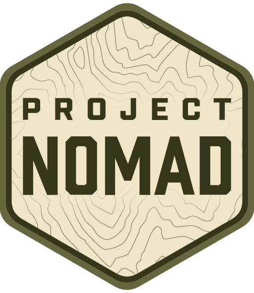

<div align="center">


# Project NOMAD — ARM64 Port
### Knowledge That Never Goes Offline — Now On Your Phone

[](https://www.projectnomad.us)
[](https://discord.com/invite/crosstalksolutions)
[](https://benchmark.projectnomad.us)

</div>

---

**Project NOMAD is an offline-first knowledge and education server. This is the ARM64 port — it runs NOMAD on ARM computers and Android phones, so you can carry the whole library in your pocket.**

No internet required after install. Wikipedia, medical references, Khan Academy lessons, offline maps, books, and a local AI helper — all running on hardware you control.

This is a reverse-engineered ARM64 port of [Crosstalk-Solutions/project-nomad](https://github.com/Crosstalk-Solutions/project-nomad) v1.35.1, which officially supports x86-64 only. Everything below is about this ARM64 version.

> **Built with agentic AI:** This port was created with the help of agentic AI (an AI coding assistant working alongside the maintainer). The code, docs, and release notes were produced collaboratively by a human and an AI agent.

## Install — the easy way

You do not need to know GitHub, and you do not need to know how to code. You just need to be able to copy and paste one command.

### What you need

- A device running **Debian or Ubuntu Linux on ARM64** — for example a Raspberry Pi, an ARM server, or an Android phone running a Debian virtual machine (see [Installing on a phone](#installing-on-a-phone) below). It also works on regular Intel/AMD computers running Debian or Ubuntu.
- An internet connection **for the install itself**. After that, NOMAD works offline.
- About **10 GB of free space**, to be comfortable.
- A password for your computer — the installer needs administrator access for a few steps and will ask for it.

### The one command

Open a terminal and copy and paste this whole line, then press Enter:

```sh
curl -fsSL https://raw.githubusercontent.com/thefortressentertainment-pixel/project-nomad-arm64/main/install.sh -o /tmp/nomad-arm-install.sh && bash /tmp/nomad-arm-install.sh
```

That downloads a small helper, which checks your machine, checks that the NOMAD images are ready, and then runs the full installer.

### What happens next

1. The helper checks your computer and prints a few lines. If something is wrong (for example, you are not on Debian/Ubuntu), it will tell you plainly and stop.
2. The installer asks two questions — type `y` and press Enter for each:
   - **"Are you sure you want to continue?"**
   - **"I have read and accept the License Agreement?"** (NOMAD is free, open-source software under the Apache License 2.0.)
3. If Docker is not installed, it installs it. Then it downloads NOMAD and starts it.
4. This takes a while on a first install — the downloads are large. On a phone it can take a lot longer, so be patient and leave it running.

When it finishes, it prints an address. Open it in your web browser:

```
http://localhost:8080
```

That is NOMAD's Command Center. From there you can set it up, add content, and use it. NOMAD starts by itself whenever your machine restarts. If you ever need to start or stop it by hand, the installer leaves helper scripts in `/opt/project-nomad/` called `start_nomad.sh` and `stop_nomad.sh`.

For the full step-by-step version of this guide, including troubleshooting, see [INSTALL-EASY.md](INSTALL-EASY.md).

### Installing on a phone

A phone cannot run NOMAD directly — it needs a small Debian virtual machine running inside the phone first. That takes a bit of setting up, and it is the fiddliest part of the whole thing. The step-by-step instructions for the phone (Termux + QEMU, no root needed) are in **[README-ARM.md](README-ARM.md)**.

Once the Debian virtual machine is running on your phone, open a terminal inside it and run the same one command above. That is the only command you need.

## How It Works
NOMAD is a management UI ("Command Center") and API that orchestrates a collection of containerized tools and resources via [Docker](https://www.docker.com/). It handles installation, configuration, and updates for everything — so you don't have to.

**Built-in capabilities include:**
- **AI Chat with Knowledge Base** — local AI chat powered by [Ollama](https://ollama.com/) or you can use OpenAI API compatible software such as LM Studio or llama.cpp, with document upload and semantic search (RAG via [Qdrant](https://qdrant.tech/))
- **Information Library** — offline Wikipedia, medical references, ebooks, and more via [Kiwix](https://kiwix.org/)
- **Education Platform** — Khan Academy courses with progress tracking via [Kolibri](https://learningequality.org/kolibri/)
- **Offline Maps** — downloadable regional maps via [ProtoMaps](https://protomaps.com)
- **Data Tools** — encryption, encoding, and analysis via [CyberChef](https://gchq.github.io/CyberChef/)
- **Notes** — local note-taking via [FlatNotes](https://github.com/dullage/flatnotes)
- **System Benchmark** — hardware scoring with a [community leaderboard](https://benchmark.projectnomad.us)
- **Supply Depot** — a one-click app catalog (PDF tools, file browser, e-book library, password manager, and more) plus the ability to run your own custom Docker containers
- **Automatic Updates** — opt-in, hands-off updates for the core software, installed apps, and offline content, on a schedule you control
- **Easy Setup Wizard** — guided first-time configuration with curated content collections

NOMAD also includes built-in tools like a Wikipedia content selector, ZIM library manager, and content explorer.

## What's Included

| Capability | Powered By | What You Get |
|-----------|-----------|-------------|
| Information Library | Kiwix | Offline Wikipedia, medical references, survival guides, ebooks |
| AI Assistant | Ollama + Qdrant | Built-in chat with document upload and semantic search |
| Education Platform | Kolibri | Khan Academy courses, progress tracking, multi-user support |
| Offline Maps | ProtoMaps | Downloadable regional maps for offline viewing and search |
| Data Tools | CyberChef | Encryption, encoding, hashing, and data analysis |
| Notes | FlatNotes | Local note-taking with markdown support |
| System Benchmark | Built-in | Hardware scoring, Builder Tags, and community leaderboard |
| Supply Depot | Built-in | One-click app catalog + bring-your-own custom Docker containers |

## What does not work on ARM

A few things from the regular version do not work on ARM computers:

- **Translate** (the translation service) — it only works on Intel/AMD.
- **Graphics-card AI** — the AI helper runs on the processor only, which is slower but works.
- **Excalidraw** — the whiteboard app is Intel/AMD only.
- Everything else — Wikipedia, lessons, maps, books, files, and the Command Center — works the same.

For the full technical notes on the port (what changed, what was verified, and the Pi/phone runbooks), see **[README-ARM.md](README-ARM.md)**.

## Device Requirements

NOMAD itself is lightweight — the base install needs about **5 GB of disk and under 1 GB of RAM**. The offline content you add afterwards is what actually fills a drive, and the AI Assistant is what drives the memory requirement up.

- **Minimum:** 2 GHz dual-core processor, 4 GB RAM, 5 GB free disk (plan for 10 GB to install comfortably), Debian-based OS.
- **For the AI Assistant:** adding Ollama and a model brings the install to roughly **25 GB**. On ARM there is no graphics-card AI, so the AI runs on the processor — use small models and expect it to be slower than on a desktop with a GPU.
- **On a phone:** an 8 GB RAM phone with about 32 GB free space works well, running NOMAD inside a Debian virtual machine. See [README-ARM.md](README-ARM.md) for the phone setup.

A stable internet connection is required during install only.

## Frequently Asked Questions (FAQ)
For answers to common questions about Project NOMAD, please see our [FAQ](FAQ.md) page.

## About Internet Usage & Privacy
Project NOMAD is designed for offline usage. An internet connection is only required during the initial installation (to download dependencies) and if you (the user) decide to download additional tools and resources at a later time. Otherwise, NOMAD does not require an internet connection and has ZERO built-in telemetry.

To test internet connectivity, NOMAD first attempts to make a request to Cloudflare's utility endpoint, `https://1.1.1.1/cdn-cgi/trace`. If that endpoint is unreachable (for example, because your network blocks `1.1.1.1`), it falls back to other endpoints the application already contacts (the GitHub API and the Project NOMAD API) and considers the connection online if any of them respond.

You can override the endpoint used for this check in two ways. The connectivity test URL can be configured from the UI under **Settings → Advanced** (stored locally on your instance), or you can set the `INTERNET_STATUS_TEST_URL` environment variable. When set, the environment variable always takes precedence over the UI-configured value. If neither is set, the built-in defaults above are used.

## About Security
By design, Project NOMAD is intended to be open and available without hurdles — it includes no authentication. If you decide to connect your device to a local network after install (e.g. for allowing other devices to access its resources), you can block/open ports to control which services are exposed.

**Will authentication be added in the future?** Maybe. It's not currently a priority, but if there's enough demand for it, we may consider building in an optional authentication layer in a future release to support use cases where multiple users need access to the same instance but with different permission levels (e.g. family use with parental controls, classroom use with teacher/admin accounts, etc.). We have a suggestion for this on our public roadmap, so if this is something you'd like to see, please upvote it here: https://roadmap.projectnomad.us/posts/1/user-authentication-please-build-in-user-auth-with-admin-user-roles

For now, we recommend using network-level controls to manage access if you're planning to expose your NOMAD instance to other devices on a local network. NOMAD is not designed to be exposed directly to the internet, and we strongly advise against doing so unless you really know what you're doing, have taken appropriate security measures, and understand the risks involved.

## Contributing
Contributions are welcome and appreciated! Please see [CONTRIBUTING.md](CONTRIBUTING.md) for guidelines on how to contribute to the project. If you run NOMAD on a phone or an ARM board and something doesn't work, opening an issue with your device and what you saw helps everyone.

## Community & Resources

- **Website:** [www.projectnomad.us](https://www.projectnomad.us) - Learn more about the project
- **Discord:** [Join the Community](https://discord.com/invite/crosstalksolutions) - Get help, share your builds, and connect with other NOMAD users
- **Benchmark Leaderboard:** [benchmark.projectnomad.us](https://benchmark.projectnomad.us) - See how your hardware stacks up against other NOMAD builds
- **FAQ:** [FAQ.md](FAQ.md) - Find answers to frequently asked questions
- **Community Add-Ons:** [admin/docs/community-add-ons.md](admin/docs/community-add-ons.md) - Third-party content packs built by the community
- **ARM port technical notes:** [README-ARM.md](README-ARM.md) - What changed for ARM, verification, Pi and phone runbooks

## License

Project NOMAD is licensed under the [Apache License 2.0](LICENSE).

## Helper Scripts
Once installed, Project NOMAD has a few helper scripts should you ever need to troubleshoot issues or perform maintenance that can't be done through the Command Center. All of these scripts are found in Project NOMAD's install directory, `/opt/project-nomad`

###

###### Start Script - Starts all installed project containers
```bash
sudo bash /opt/project-nomad/start_nomad.sh
```
###

###### Stop Script - Stops all installed project containers
```bash
sudo bash /opt/project-nomad/stop_nomad.sh
```
###

###### Update Script - Attempts to pull the latest images for the Command Center and its dependencies (i.e. mysql) and recreate the containers. Note: this *only* updates the Command Center containers. It does not update the installable application containers - that should be done through the Command Center UI
```bash
sudo bash /opt/project-nomad/update_nomad.sh
```

###### Uninstall Script - Need to start fresh? Use the uninstall script to make your life easy. Note: this cannot be undone!
```bash
curl -fsSL https://raw.githubusercontent.com/Crosstalk-Solutions/project-nomad/refs/heads/main/install/uninstall_nomad.sh -o uninstall_nomad.sh && sudo bash uninstall_nomad.sh
```
